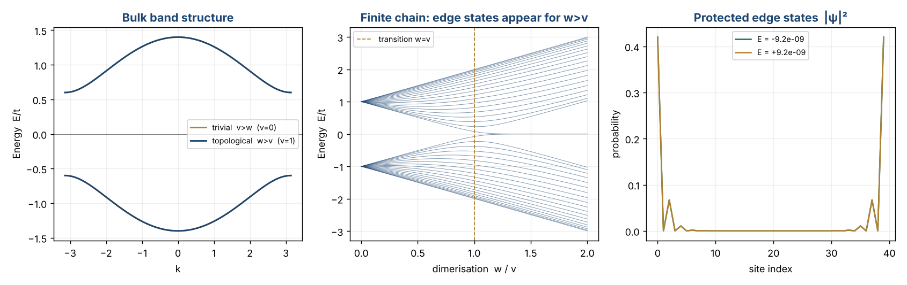
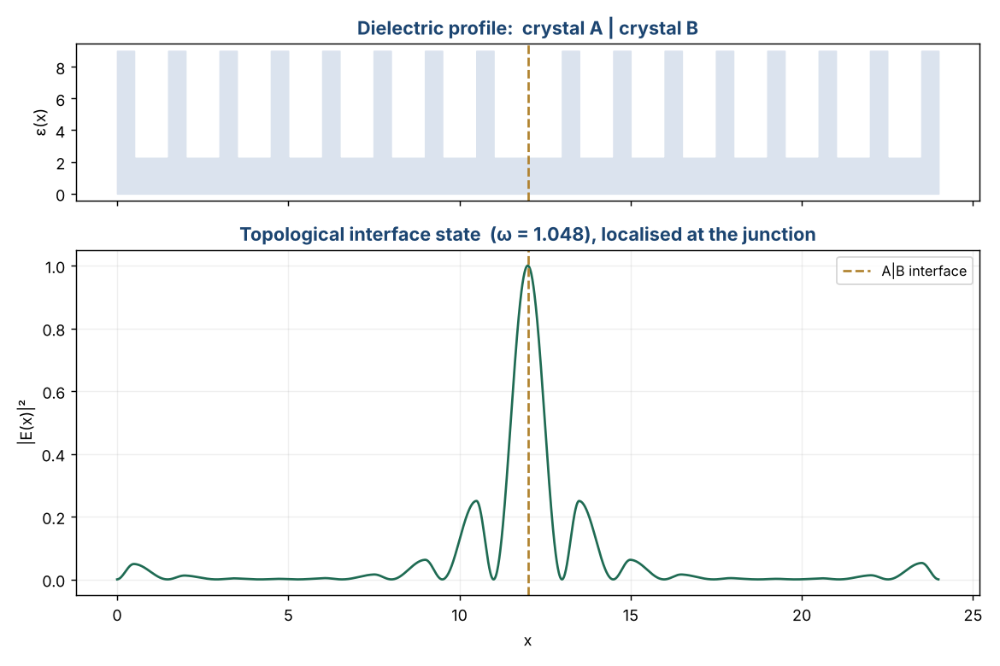

# Topological Photonics — from the SSH model to a photonic interface state

Computational study of **topological photonics**: how a topological invariant
of a periodic structure guarantees a robust, localised state at its boundary.
The repository builds the idea up from the simplest model (SSH) to a real 1D
**photonic crystal** that hosts a protected **interface state** inside its band
gap — the operating principle of topological waveguides.

> Computational companion to my RISE-X research project at UM6P
> (full-wave COMSOL study of topological photonic waveguides, supervised by
> Dr. Lan Zihao). These lightweight, fully reproducible scripts reproduce the
> underlying physics in Python; the COMSOL workflow is summarised below.

---

## 1 · The SSH model — bulk topology and edge states



- **Bulk bands** `E(k) = ±|v + w e^{ik}|` open a gap for `v ≠ w`.
- The **winding number** ν of the off-diagonal Bloch term is the topological
  invariant: `ν = 0` (trivial, `v > w`) or `ν = 1` (topological, `w > v`).
- A **finite chain** in the topological phase (`w > v`) hosts two protected
  **zero-energy edge states** — visible as the mid-gap branch (centre panel)
  and as modes localised at the two ends (right panel).

```
trivial (v>w)        winding = 0   near-zero edge modes = 0
topological (w>v)    winding = 1   near-zero edge modes = 2
```

## 2 · A real photonic interface state

Two dielectric Bragg stacks that share a band gap but differ in layer order
(A = hi|lo, B = lo|hi) carry **different Zak phases** in that gap. Joining them
creates a protected mode pinned to the junction:



Solving the 1D Helmholtz equation by finite differences and targeting the band
gap with a shift-invert eigensolver, the mode sits at **ω ≈ 1.05 inside the
gap** with **~83 % of its energy within ±2 unit lengths of the interface** — a
genuine topological interface state, not a band mode.

---

## Files

| File | Purpose |
|---|---|
| `ssh_model.py` | SSH Hamiltonian, bulk bands, winding number, finite-chain spectrum. |
| `plot_ssh.py` | Figure: bulk bands, dimerisation sweep, edge-state profiles. |
| `photonic_crystal_zak.py` | Transfer-matrix band structure and Zak-phase classification of a 1D photonic crystal. |
| `interface_state.py` | FDFD solve of the A\|B stack; finds and plots the gap interface state. |

## COMSOL workflow (RISE-X project)

The full-wave study that these scripts accompany was set up in COMSOL
Multiphysics (Wave Optics / Electromagnetic Waves, Frequency Domain):

1. **Unit cell + Floquet periodicity** to compute the photonic band structure
   and confirm a complete band gap.
2. **Zak phase / symmetry analysis** of the bands on either side of the gap to
   assign the topological character.
3. **Supercell with an interface** (or a bent waveguide) to obtain the
   localised interface/edge mode and its frequency within the gap.
4. **Robustness tests** — disorder in layer thickness and index, and sharp
   bends — compared against a conventional (topologically trivial) waveguide.

The Python code reproduces steps 1–3 in 1D so the physics is transparent and
anyone can run it without a COMSOL licence.

---

## Run it

```bash
pip install numpy scipy matplotlib
python plot_ssh.py          # SSH bands + edge states
python photonic_crystal_zak.py
python interface_state.py   # photonic interface state
```

## References
- Su, Schrieffer, Heeger, *Phys. Rev. Lett.* **42**, 1698 (1979).
- Ozawa *et al.*, "Topological photonics", *Rev. Mod. Phys.* **91**, 015006 (2019).

---

**Author** — Wendlasida Rodrigue Kientega · Applied Physics Engineering, UM6P
License: MIT
